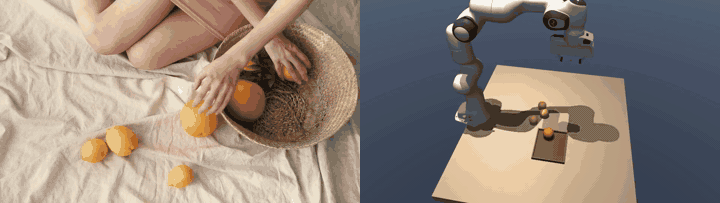
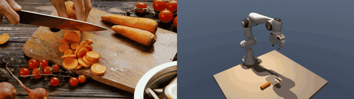
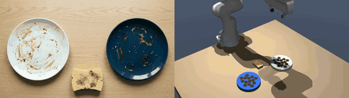
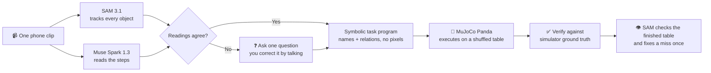

<div align="center">


# ShowOnce

**Film a tabletop task once. The robot watches, asks if it is unsure, then does it on a shuffled table.**

<table>
<tr>
<td align="center"><a href="demos/pexels_fruit_basket/robot.mp4"></a><br /><sub><b>Fruit into a basket</b>: the clip, then the arm</sub></td>
<td align="center"><a href="demos/pexels_cut_carrots/robot.mp4"></a><br /><sub><b>Chop a carrot</b>: the clip, then the arm</sub></td>
<td align="center"><a href="web/public/robot-demo.mp4"></a><br /><sub><b>Clean a plate</b>: the arm scrubbing, in circles</sub></td>
</tr>
</table>

<sub>Left and middle: real stock footage on the left of each pair, the robot on the right (sped up). <a href="#see-it-work">All demos</a></sub>

[](https://dev.meta.ai/)
[](pyproject.toml)
[](https://mujoco.org/)
[](TECHNICAL.md)
[](LICENSE)

SAM 3.1 watches the clip · Muse Spark 1.3 reads the steps · MuJoCo Panda does the task

</div>

> Built for the Meta Global AI Developer Hackathon 2026 (indie track, “Push the Frontier”).

## The idea

A home is the hardest place to put a robot. Every kitchen is different. The dishes go in a different rack, the toys in a different bin, the lamp is a different lamp. You cannot ship a robot with every household job pre-programmed, and you cannot ask a family to collect hundreds of demonstrations or write code.

But a person can already teach almost anything by **showing it once**. A parent shows a child how the dishes go in the rack. A friend shows you how they like the carrots cut. Nobody hands over a dataset.

**ShowOnce is built on that gap.** The goal is a robot that picks up a new household skill the way a person does: you do the task once on camera, it watches, tells you in plain words what it understood, and then does the job itself, on a table that looks nothing like the one in your clip.

> *Show a robot a task once. It learns the rule, applies it to a new table, and checks its own work.*

### What makes this hard, and what we did about it

| Problem with learning from one demo | What ShowOnce does |
|---|---|
| **A video is not a program.** Pixels and hand motion do not transfer to another table. | It learns the *task*, not the motion: a short list of steps made only of object names and relations (“lemon → basket”, “stir the bowl”). No coordinates are stored, so the program is valid on any layout. |
| **A hand hides what it moves.** Tracking an object through a grasp is unreliable. | It compares where each object *rested* before and after every move. A jump between two rests is a move. |
| **One demo is ambiguous.** Was “red on blue” about colour or size? | Two independent readings of the clip (SAM tracking and Muse Spark watching the video) are cross-checked. If they disagree, or the person wants to add detail, it talks it through before anything moves. |
| **Some chores leave no trace.** Wiping, pouring, stirring and cutting do not change where things sit. | Muse Spark’s reading of the video decides those steps, and each has its own motion in the simulator. |
| **A robot that cannot check itself cannot be trusted.** | Every step is checked against simulator ground truth, then a second time by looking at the finished table through SAM, like a camera would. A miss is fixed once. |

### The skill in use

1. **You show it.** Film a task once with a phone: three lemons into a basket, sugar poured and stirred, a carrot cut into slices.
2. **It looks and listens.** SAM 3.1 finds and tracks every object. Muse Spark 1.3 watches the same clip and says, in its own words, what it thinks you did.
3. **You agree or correct it.** It waits. You answer in plain language until it has it right. It can only name objects that are really on the table.
4. **It plans in its own way.** The plan is a program of ten possible actions. It does not copy your hand: a wipe becomes its own scrub, a put becomes a pick and place.
5. **It does the job on a new table.** Objects are shuffled, SAM finds them again, and the Panda arm does each step.
6. **It checks its own work.** Simulator ground truth, then SAM on the finished table. Failures are reported, not hidden.

## See it work

Each folder in [`demos/`](demos/) holds the clip ShowOnce watched (`human.mp4`), the arm repeating it (`robot.mp4`), and the same program on a shuffled table (`robot_shuffled.mp4`). The studio’s landing page plays them side by side (`uv run showonce ui`, then the **Watch it** section).

| Demo | What it was shown | What the robot learned | Footage |
|---|---|---|---|
| [`pexels_fruit_basket`](demos/pexels_fruit_basket) | a baker drops fruit in a basket | four `place_in` steps: three lemons and an orange | real stock footage |
| [`pexels_sugar_mix`](demos/pexels_sugar_mix) | a baker pours sugar and stirs it in | `pour`, then `stir` until the colour blends | real stock footage |
| [`pexels_cut_carrots`](demos/pexels_cut_carrots) | a carrot sliced on a board | `cut`: a lying carrot becomes ten slices piled beside it | real stock footage |
| [`toys_into_bin`](demos/toys_into_bin) | three toys go in a bin | three `place_in` steps | AI-generated |
| [`dishes_into_rack`](demos/dishes_into_rack) | three dishes go in a rack | three `place_in` steps | AI-generated |
| [`lamp_press`](demos/lamp_press) | a push light is clicked on | `press` | AI-generated |
| [`tidy_table`](demos/tidy_table) | nothing: the robot plans alone | fruit into the bowl, blocks stacked | none (robot only) |

The first six replay on a shuffled table with every step verified, and SAM finds the objects within 3 mm of simulator ground truth. Three of the six clips are real stock footage; the rest are AI-generated and have small glitches.

For how it works inside (stages, models, simulator, verification, limits) see [TECHNICAL.md](TECHNICAL.md).

## Contents

- [The idea](#the-idea)
- [See it work](#see-it-work)
- [How it works](#how-it-works)
- [Teach it your own clip](#teach-it-your-own-clip)
- [Skills](#skills)
- [How objects are modelled](#how-objects-are-modelled)
- [Quickstart](#quickstart)
- [Web app](#web-app)
- [Sample clips](#sample-clips)
- [Development](#development)
- [Where this goes](#where-this-goes)
- [Technical overview](TECHNICAL.md)

## How it works



1. **Calibrate.** The frame is mapped onto a fixed table rectangle, and the simulator’s camera sees the same rectangle, so a pixel means the same thing in the clip and in the sim.
2. **Perceive.** SAM 3.1 tracks each object through the clip from a short noun phrase. Because hands hide objects during a move, only the resting positions before and after each move are used. Muse Spark looks at the first frame and describes each object (shape, size, handle, colour) so the simulator can rebuild it.
3. **Understand.** Each move is explained from geometry: landing inside a container is `place_in`, landing on another object is `stack_on`, landing beside one is `place_near`. Muse Spark independently watches the video and returns steps as schema-checked JSON. Where the two disagree, it asks. Where geometry cannot see the action (wipe, open, pour, stir, cut, press), Muse Spark’s reading is used.
4. **Compile.** The steps become a symbolic **task program** with ten possible actions, using names only. It is saved as `program.json` and can be replayed on any layout.
5. **Act.** A Franka Panda in MuJoCo performs each step with its own motion. On a replay the robot does not know where things are: it renders its camera, and SAM finds each object by a phrase built from its profile.
6. **Verify.** Each step is checked against simulator ground truth. Then the arm parks, the camera looks at the finished table, and SAM compares what it sees with each step’s goal. A step it sees as missed is run once more, from where SAM saw things.

The stages, models and checks are described in detail in [TECHNICAL.md](TECHNICAL.md).

ShowOnce claims task-level imitation (what moved where, in what order). It does not learn dexterous motor skills.

## Teach it your own clip

Press **Your clip** in the studio and pick an overhead mp4. You do not name anything:

1. **It looks.** Muse Spark reads the clip's first frame and lists what is on the table (objects and containers), and SAM 3.1 tracks each one through the clip.
2. **It speaks first, in words.** Muse Spark watches the clip and says what it understood the way a person would ("I saw you wipe off the white plate with the yellow sponge… did I get it right?"). It does not read out a list of steps, and it waits. Nothing moves yet.
3. **You talk it through.** Answer, correct it, or add detail in your own words, as many times as you like. Each reply restates what it now understands and asks again, or asks one short question if something is unclear. Its answers are checked before they are used: a plan can only name objects and containers that are really on the table, so the model cannot invent things.
4. **You say it is right, and then it shows its plan** with how it will do each step. It does not copy the hand: a wipe becomes its own circular scrub, an open becomes its own tear, a put becomes a pick and place, wherever things are on the table. What carries over is the goal, not the motion. The steps stay editable in place.
5. **The robot starts only after you approve**, runs on a shuffled table with a live caption of what it is doing, and checks the outcome.

The same steps work for the sample clips, which come with a scene file for repeatable tests.

## Skills

A learned step is one action, each with its own motion in the simulator and a check against simulator ground truth (`src/showonce/sim/skills.py`, `executor.py`):

| Action | Meaning | In the sim | Status |
|---|---|---|---|
| `place_in` | put an object in a container | pick, carry, set down inside the tray's rim | ✅ shipped |
| `stack_on` | put an object on another | same, onto the top of the one below | ✅ shipped |
| `wipe` | clean a dish or surface with a sponge or cloth | pick up the tool, sweep a back-and-forth raster over the whole surface; every stain it passes over is cleared | ✅ shipped |
| `open` | tear open a bag or packet | take the seal strip along the bag's top edge by its protruding end, tear it off and lay it beside the bag, as the hand does in the clip | ✅ shipped |
| `place_near` | put an object beside another on open table | pick-place to a free spot at the stated relation (`left_of`, `right_of`, `in_front_of`, `behind`, `next_to`) | ✅ shipped |
| `push` | slide a wide or flat object without grasping it | controller drives from behind at low height; contact does the work | ✅ shipped |
| `pour` | pour a cup into a container | grasp, carry above the target, tilt the wrist, put the cup back | ✅ shipped |
| `stir` | stir a container with a tool | circles inside the container rim, tool above the floor | ✅ shipped |
| `cut` | cut a box in two with a knife | one straight sweep; the box becomes two halves | ✅ shipped |
| `press` | press a button, pump or push-light | descend straight down, dwell, retract | ✅ shipped |

Where things ended up cannot show a wipe or a tear, and neither can it show a pour, a stir, a cut or a press, so when Muse Spark reads any of those in the clip, its reading is used instead of the motion tracking — Muse Spark's reading is used for all of `SEMANTIC_ACTIONS` (`wipe`, `open`, `pour`, `stir`, `cut`, `press`). These are simulator abstractions: there is no fluid or cloth physics, pour and stir contents are an abstract disc with no fluid physics, and a “tear” is a seal strip coming off a flat bag, not a bag ripping. A push keeps an object's true size because it is never grasped. Nothing here has been tested on real footage yet.

## SAM checks its own work

Simulator ground truth can be called circular, so the robot also looks. After a run it parks the arm, renders the top camera, finds each object with SAM 3.1, and compares what it sees with every step's goal (`src/showonce/verify.py`). A step it sees as missed is run once more, starting from what SAM saw.

```bash
uv run showonce replay runs/<name>/program.json --scene runs/<name>/scene.json --sam-verify --slip "red block"
```

`--slip` drops one object on open table after the run, to stage a miss. What a top-down picture can show (`place_in`, `stack_on`, `place_near`, `push`) is judged from SAM. A block with something stacked on it cannot be seen, so it is judged against where it was first seen, or from simulator state if it has since moved. Pour, stir, cut, press, open and wipe are judged from simulator state too, and the report labels each check `SAM:` or `sim:`.

## Tidy mode

Scatter a scene's objects, and the robot looks (SAM 3.1), plans (Muse Spark 1.3, in the same ten-verb language a learned demo compiles to), tidies, then checks itself with SAM:

```bash
uv run showonce tidy samples/tidy_table.json --seed 1 --out runs/tidy.mp4
uv run showonce tidy samples/tidy_table.json --seed 1 --slip "yellow lemon"   # stage a miss, watch it fix it
uv run showonce tidy samples/tidy_table.json --goal "group fruit away from the blocks"
```

Muse Spark sees the picture plus each object's table position and may only use `place_in`, `stack_on`, `place_near` and `push`. Its plan is cleaned before anything moves (`clean_plan` in `src/showonce/tidy.py`): a step that names an unknown object, moves one twice, moves something with a block stacked on it, or stacks on a ball is dropped, and the dropped steps are printed.

Measured so far (one scene, one seed, live API calls, so a demonstration and not a score): Muse Spark planned four steps, all four verified; with the lemon dropped on open table after the run, SAM saw the miss and the robot put the lemon in the bowl on its second try. The plan changes from run to run. Not yet run: other scenes, other seeds, real photos.

## How objects are modelled

Any object in a clip is reduced to a box, cylinder or sphere with a real size, a colour and an optional handle (`src/showonce/objects.py`). When learning, Muse Spark looks at the first frame and describes each object (shape, width, depth, height, handle), and the pixels give the colour of anything whose name has no colour word. The profile is saved with the scene, so the simulator rebuilds a mug as a mug, an apple as a ball and a book as a flat box, whatever it is called. Names are only a fallback guess when Muse Spark cannot answer.

- **It looks like the real thing.** Each box-shaped object (a chips bag, a book, a sponge) and each round dish without a handle is cut out of the clip's first frame, and that picture is laid on top of the simulated object, so the robot's table shows the actual label and colours, not a plain block. A box also takes the proportions of its picture. Things that get wiped keep a plain top, because their stains are simulated and a picture with real stains would never look clean; mugs and fruit keep their colours (a handle or a curved surface would skew the crop). It is a photograph on a flat box, not a 3D model of the object.
- Containers are shallow rimmed trays sized from the box SAM found around them in the clip.
- The sim gripper opens 8 cm, so wider objects are scaled down to fit. Stacking on a ball is refused with a clear error.
- SAM finds each object in the sim by a phrase built from its profile (“red mug”, “orange ball”), so two objects with the same colour and shape would be confused.

## Quickstart

Requires [uv](https://docs.astral.sh/uv/).

```bash
uv sync
cp .env.example .env   # then add your MODEL_API_KEY
uv run showonce --help
```

```bash
./scripts/fetch_assets.sh                  # downloads the Panda model
uv run showonce demo samples/toys_into_bin.mp4 --scene samples/toys_into_bin.json
uv run showonce eval-demo                  # score video -> program -> robot on samples/
uv run showonce replay runs/toys_into_bin/program.json \
    --scene runs/toys_into_bin/scene.json --seed 3   # shuffled layout, SAM finds the blocks
uv run showonce eval-replay                # every sample x 3 shuffled layouts
uv run showonce sim-test                   # 10 random block stacks, no API needed
uv run showonce ui                         # the web app (see below)
```

## Web app

`make backend` (or `uv run showonce ui`) serves the app at http://127.0.0.1:8000. It is two pages:

- **The landing page** (`#/`) carries the message: what it is, how it works in three steps, a **Watch it** player for the finished demos (the clip it watched, the arm repeating it, and the shuffled table, no API key needed), what it can do grouped into four things (learn from one clip, check it understood, do the job its own way, check its own work), the demo clips grouped by kind of task, and what has been measured.
- **The studio** (`#/studio`) is where the work happens, in three stages shown at the top: **Show it once** (pick a clip or upload your own and let the robot watch), **Talk it through** (the conversation above, then the agreed plan), and **Watch it work**. The robot gets the big stage on the right: the cell at rest, locked until you approve, then the arm at work with a caption of what it is doing and how, the plan lighting up in step, and playback at 2× by default. After a run SAM checks the finished table and the arm fixes a miss once. *Options → Make it slip* drops an object after the run so you can watch that check catch it.

`#/studio?clip=dishes_wash` opens a clip directly. Clips carry a `title` and a `group` in their scene file, which is how they are grouped.

The frontend is React, TypeScript and Tailwind in `web/`:

```bash
cd web && pnpm install
pnpm dev        # http://localhost:5173, proxies /api to the Python server
                # (SHOWONCE_API=http://127.0.0.1:8001 pnpm dev to point it elsewhere)
pnpm build      # writes web/dist, which `showonce ui` serves
pnpm test && pnpm typecheck && pnpm lint
```

## Sample clips

The finished human-and-robot pairs are in `demos/`. `samples/` holds six demo clips, each with a scene file naming the objects and containers. Two are AI-generated put-and-place footage (see `scripts/generate_videos.py`, a development tool that is not part of the product): `toys_into_bin` and `dishes_into_rack` (30 s), with small size glitches in the objects. `lamp_press` (press the orange push light so it clicks on) is AI-generated and trimmed to the part without glitches. Three are real Pexels stock footage: `pexels_fruit_basket` (top-down: three lemons and an orange go into a basket, so the robot learns four steps), `pexels_cut_carrots` (an angled close-up of carrot slicing: the robot chops a lying carrot into ten slices and piles them beside it, on a default layout), `pexels_sugar_mix` (top-down: a baker pours sugar into a bowl and stirs it; objects are profiled by hand because the spoon is in a hand in the first frame). Replays of the three real clips on seeds 3, 7 and 11 all passed, with SAM within 2 mm. A portrait clip was dropped: the table mapping assumes a landscape frame.

Four earlier AI clips were withdrawn because the footage itself was flawed or a real clip replaced them. `fruit_into_bowl` gave way to `pexels_fruit_basket`; the others: `dishes_wash` (stains vanish between frames and the sponge changes shape), `cooking_prep` (the dough bar appears from nowhere) and `book_push_aside` (the pushed book slides back to where it began). Their scene files stay, and wipe, push and cut are still covered by the simulator tests; Put real phone clips next to them with a scene file of the same shape.

Eight synthetic clips with pixel-level ground truth, used for the move-detection eval, are rebuilt locally with `uv run showonce synth` (written to the git-ignored `samples/synthetic/`).

## Development

```bash
uv run pytest          # tests (no network needed)
uv run ruff check .    # lint
uv run ruff format .   # format
uv run mypy            # type check
```

## Where this goes

Everything here runs in simulation, on a handful of coloured objects, with an arm that grasps by constraint. What would make it a household robot is the next set of problems, not a different idea:

- **Real hands and real grasping**, so the same programs run on a physical arm.
- **Real kitchens**: more cluttered scenes, mixed lighting, objects that look alike.
- **A growing skill library.** A program learned once is a named, readable skill. Skills can be kept, edited, chained, and shared between robots.
- **Teaching by talking** that carries on over days: “no, the other rack”, “like last time but with the blue cups”.

The core bet is that the task, not the motion, is the thing worth learning from one demonstration.

## Limits, stated plainly

- Task-level imitation only: what moved where, in what order. No dexterous or contact-rich motor skills, no real hardware yet.
- Fixed, roughly top-down camera; 3–4 distinctly coloured objects; steady light.
- Simulator abstractions stand in for fluids, cloth and tearing. Real footage is untested.

## License

MIT. See [LICENSE](LICENSE).
