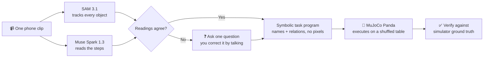

<div align="center">


# ShowOnce

**Film a tabletop task once. The robot watches, asks if it is unsure, then does it on a shuffled table.**

[](https://dev.meta.ai/)
[](pyproject.toml)
[](https://mujoco.org/)
[](LICENSE)

SAM 3.1 watches the clip · Muse Spark 1.3 reads the steps · MuJoCo Panda does the task

</div>

> **Status:** Built for the Meta Global AI Developer Hackathon 2026 (indie track, “Push the Frontier”). All ten actions in the Skills table below are shipped.

## Contents

- [Why ShowOnce](#why-showonce)
- [How it works](#how-it-works)
- [Results](#results)
- [Teach it your own clip](#teach-it-your-own-clip)
- [Skills](#skills)
- [How objects are modelled](#how-objects-are-modelled)
- [Quickstart](#quickstart)
- [Web app](#web-app)
- [Sample clips](#sample-clips)
- [Development](#development)

## Why ShowOnce

Programming a robot usually takes an expert or a large demonstration set. People teach by showing once. But one demo is ambiguous: was that “red on blue” about colour or about size?

ShowOnce is built around that problem. It watches one short clip, notices when the demo could mean more than one thing, asks **one** clarifying question, then performs the task from a new layout of the objects, and checks its own work.

**One-liner:** Show a robot a task once. It learns the rule, applies it to a new table, and checks the result.

## How it works



1. **SAM 3.1** tracks each colored object in the clip. Because hands hide objects during a move, only the resting positions before and after each move are compared.
2. **Muse Spark 1.3** watches the same clip and returns the steps as structured JSON.
3. The steps compile into a symbolic task program (object names and relations, no pixel positions).
4. A **MuJoCo** Panda arm executes the program. A stored program can be replayed on a shuffled layout, with SAM re-finding the objects.
5. Every step is checked against simulator ground truth. The robot reports what it actually did, including failures. A second check looks at the finished table through SAM, like a camera would, and fixes a miss once (see below).

ShowOnce claims task-level imitation (what moved where, in what order). It does not learn dexterous motor skills.

## Results

Learn from the clip, then run on shuffled tables (seeds 3 and 7) with SAM finding the objects in the simulator. These are AI-generated test clips, not real footage, and failures are kept in the table.

| Clip | Steps learned | Read by | Seed 3 | Seed 7 |
|---|---|---|---|---|
| dishes_into_rack | 3 of 3 correct | motion | 3/3 steps | 3/3 steps |
| fruit_into_bowl | 3 of 3 correct | motion | 3/3 steps | 3/3 steps |
| toys_into_bin | 3 of 3 correct | Muse Spark (motion could not explain a move) | 3/3 steps | 3/3 steps |
| dishes_wash | 2 of 2 correct (wipe each plate) | Muse Spark (a wipe is not visible to tracking) | 2/2 steps, 28 of 28 stains | 2/2 steps, 28 of 28 stains |
| cooking_prep | 3 of 3 correct (cut, pour, stir) | Muse Spark (cut, pour and stir are not visible to tracking) | 3/3 steps | 3/3 steps |
| book_push_aside | not yet evaluated | — | not yet evaluated | not yet evaluated |
| lamp_press | not yet evaluated | — | not yet evaluated | not yet evaluated |

SAM position error: 0.1 to 3.3 mm across all five clips. The dish-wash clip also passed on seeds 2, 5 and 11. The two clips `book_push_aside` and `lamp_press` have scene files ready; their footage generates on demand and they have not been evaluated yet, so no scores are claimed for them.

## Teach it your own clip

Press **Your clip** in the studio and pick an overhead mp4. You do not name anything:

1. **It looks.** Muse Spark reads the clip's first frame and lists what is on the table (objects and containers), and SAM 3.1 tracks each one through the clip.
2. **It speaks first, in words.** Muse Spark watches the clip and says what it understood the way a person would ("I saw you wipe off the white plate with the yellow sponge… did I get it right?"). It does not read out a list of steps, and it waits. Nothing moves yet.
3. **You talk it through.** Answer, correct it, or add detail in your own words, as many times as you like. Each reply restates what it now understands and asks again, or asks one short question if something is unclear. Its answers are checked before they are used: a plan can only name objects and containers that are really on the table, so the model cannot invent things.
4. **You say it is right, and then it shows its plan** with how it will do each step. It does not copy the hand: a wipe becomes its own circular scrub, an open becomes its own tear, a put becomes a pick and place, wherever things are on the table. What carries over is the goal, not the motion. The steps stay editable in place.
5. **The robot starts only after you approve**, runs on a shuffled table with a live caption of what it is doing, and checks the outcome.

The same steps work for the sample clips, which come with a scene file for repeatable tests.

## Skills

A learned step is one action, each with its own motion in the simulator and a check against simulator ground truth (`src/showonce/sim/skills.py`, `executor.py`):

| Action | Meaning | In the sim | Status |
|---|---|---|---|
| `place_in` | put an object in a container | pick, carry, set down inside the tray's rim | ✅ shipped |
| `stack_on` | put an object on another | same, onto the top of the one below | ✅ shipped |
| `wipe` | clean a dish or surface with a sponge or cloth | pick up the tool, sweep a back-and-forth raster over the whole surface; every stain it passes over is cleared | ✅ shipped |
| `open` | tear open a bag or packet | take the seal strip along the bag's top edge by its protruding end, tear it off and lay it beside the bag, as the hand does in the clip | ✅ shipped |
| `place_near` | put an object beside another on open table | pick-place to a free spot at the stated relation (`left_of`, `right_of`, `in_front_of`, `behind`, `next_to`) | ✅ shipped |
| `push` | slide a wide or flat object without grasping it | controller drives from behind at low height; contact does the work | ✅ shipped |
| `pour` | pour a cup into a container | grasp, carry above the target, tilt the wrist, put the cup back | ✅ shipped |
| `stir` | stir a container with a tool | circles inside the container rim, tool above the floor | ✅ shipped |
| `cut` | cut a box in two with a knife | one straight sweep; the box becomes two halves | ✅ shipped |
| `press` | press a button, pump or push-light | descend straight down, dwell, retract | ✅ shipped |

Where things ended up cannot show a wipe or a tear, and neither can it show a pour, a stir, a cut or a press, so when Muse Spark reads any of those in the clip, its reading is used instead of the motion tracking — Muse Spark's reading is used for all of `SEMANTIC_ACTIONS` (`wipe`, `open`, `pour`, `stir`, `cut`, `press`). These are simulator abstractions: there is no fluid or cloth physics, pour and stir contents are an abstract disc with no fluid physics, and a “tear” is a seal strip coming off a flat bag, not a bag ripping. A push keeps an object's true size because it is never grasped. Nothing here has been tested on real footage yet.

## SAM checks its own work

Simulator ground truth can be called circular, so the robot also looks. After a run it parks the arm, renders the top camera, finds each object with SAM 3.1, and compares what it sees with every step's goal (`src/showonce/verify.py`). A step it sees as missed is run once more, starting from what SAM saw.

```bash
uv run showonce replay runs/<name>/program.json --scene runs/<name>/scene.json --sam-verify --slip "red block"
```

`--slip` drops one object on open table after the run, to stage a miss. What a top-down picture can show (`place_in`, `stack_on`, `place_near`, `push`) is judged from SAM. A block with something stacked on it cannot be seen, so it is judged against where it was first seen, or from simulator state if it has since moved. Pour, stir, cut, press, open and wipe are judged from simulator state too, and the report labels each check `SAM:` or `sim:`.

## Tidy mode

No demo clip. Scatter a scene's objects, and the robot looks (SAM 3.1), plans (Muse Spark 1.3, in the same ten-verb language a learned demo compiles to), tidies, then checks itself with SAM:

```bash
uv run showonce tidy samples/tidy_table.json --seed 1 --out runs/tidy.mp4
uv run showonce tidy samples/tidy_table.json --seed 1 --slip "yellow lemon"   # stage a miss, watch it fix it
uv run showonce tidy samples/tidy_table.json --goal "group fruit away from the blocks"
```

Muse Spark sees the picture plus each object's table position and may only use `place_in`, `stack_on`, `place_near` and `push`. Its plan is cleaned before anything moves (`clean_plan` in `src/showonce/tidy.py`): a step that names an unknown object, moves one twice, moves something with a block stacked on it, or stacks on a ball is dropped, and the dropped steps are printed.

Measured so far (one scene, one seed, live API calls, so a demonstration and not a score): Muse Spark planned four steps, all four verified; with the lemon dropped on open table after the run, SAM saw the miss and the robot put the lemon in the bowl on its second try. The plan changes from run to run. Not yet run: other scenes, other seeds, real photos.

## How objects are modelled

Any object in a clip is reduced to a box, cylinder or sphere with a real size, a colour and an optional handle (`src/showonce/objects.py`). When learning, Muse Spark looks at the first frame and describes each object (shape, width, depth, height, handle), and the pixels give the colour of anything whose name has no colour word. The profile is saved with the scene, so the simulator rebuilds a mug as a mug, an apple as a ball and a book as a flat box, whatever it is called. Names are only a fallback guess when Muse Spark cannot answer.

- **It looks like the real thing.** Each box-shaped object (a chips bag, a book, a sponge) and each round dish without a handle is cut out of the clip's first frame, and that picture is laid on top of the simulated object, so the robot's table shows the actual label and colours, not a plain block. A box also takes the proportions of its picture. Things that get wiped keep a plain top, because their stains are simulated and a picture with real stains would never look clean; mugs and fruit keep their colours (a handle or a curved surface would skew the crop). It is a photograph on a flat box, not a 3D model of the object.
- Containers are shallow rimmed trays sized from the box SAM found around them in the clip.
- The sim gripper opens 8 cm, so wider objects are scaled down to fit. Stacking on a ball is refused with a clear error.
- SAM finds each object in the sim by a phrase built from its profile (“red mug”, “orange ball”), so two objects with the same colour and shape would be confused.

## Quickstart

Requires [uv](https://docs.astral.sh/uv/).

```bash
uv sync
cp .env.example .env   # then add your MODEL_API_KEY
uv run showonce --help
```

```bash
./scripts/fetch_assets.sh                  # downloads the Panda model
uv run showonce demo samples/toys_into_bin.mp4 --scene samples/toys_into_bin.json
uv run showonce eval-demo                  # score video -> program -> robot on samples/
uv run showonce replay runs/toys_into_bin/program.json \
    --scene runs/toys_into_bin/scene.json --seed 3   # shuffled layout, SAM finds the blocks
uv run showonce eval-replay                # every sample x 3 shuffled layouts
uv run showonce sim-test                   # 10 random block stacks, no API needed
uv run showonce ui                         # the web app (see below)
```

## Web app

`make backend` (or `uv run showonce ui`) serves the app at http://127.0.0.1:8000. It is two pages:

- **The landing page** (`#/`) carries the message: what it is, how it works in three steps, what it can do grouped into four things (learn from one clip, check it understood, do the job its own way, check its own work), the demo clips grouped by kind of task, and what has been measured.
- **The studio** (`#/studio`) is where the work happens, in three stages shown at the top: **Show it once** (pick a clip or upload your own and let the robot watch), **Talk it through** (the conversation above, then the agreed plan), and **Watch it work**. The robot gets the big stage on the right: the cell at rest, locked until you approve, then the arm at work with a caption of what it is doing and how, the plan lighting up in step, and playback at 2× by default. After a run SAM checks the finished table and the arm fixes a miss once. *Options → Make it slip* drops an object after the run so you can watch that check catch it.

`#/studio?clip=dishes_wash` opens a clip directly. Clips carry a `title` and a `group` in their scene file, which is how they are grouped.

The frontend is React, TypeScript and Tailwind in `web/`:

```bash
cd web && pnpm install
pnpm dev        # http://localhost:5173, proxies /api to the Python server
                # (SHOWONCE_API=http://127.0.0.1:8001 pnpm dev to point it elsewhere)
pnpm build      # writes web/dist, which `showonce ui` serves
pnpm test && pnpm typecheck && pnpm lint
```

## Sample clips

`samples/` holds six test clips of a tabletop task, each with a scene file naming the objects and containers: `toys_into_bin`, `dishes_into_rack` and `fruit_into_bowl` (30 s, put-and-place), `dishes_wash` (20 s, scrubbing two stained plates with a sponge), and `cooking_prep` (30 s, one cooking session: cut a dough bar, pour cereal into a bowl, stir it). They are AI-generated test footage (see `scripts/generate_videos.py`, a development tool that is not part of the product), not real recordings. Put real phone clips next to them with a scene file of the same shape.

Two more scene files are ready, with footage that generates on demand (the mp4s are not generated yet): `book_push_aside` (push the green book behind the red block without lifting it) and `lamp_press` (press the orange push light so it clicks on).

Eight synthetic clips with pixel-level ground truth, used for the move-detection eval, are rebuilt locally with `uv run showonce synth` (written to the git-ignored `samples/synthetic/`).

## Development

```bash
uv run pytest          # tests (no network needed)
uv run ruff check .    # lint
uv run ruff format .   # format
uv run mypy            # type check
```

## Limits, stated plainly

- Task-level imitation only: what moved where, in what order. No dexterous or contact-rich motor skills, no real hardware yet.
- Fixed, roughly top-down camera; 3–4 distinctly coloured objects; steady light.
- Simulator abstractions stand in for fluids, cloth and tearing. Real footage is untested.

## License

MIT. See [LICENSE](LICENSE).
